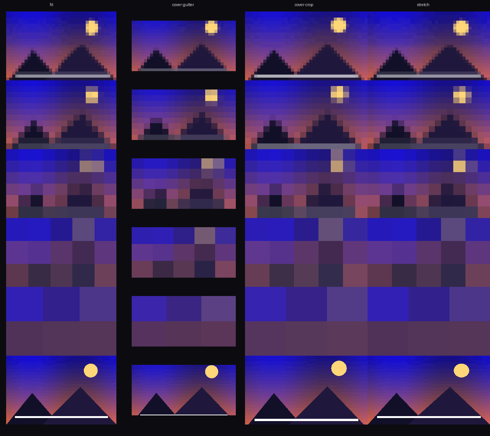

# pixelated-papers

Forced-pixelation wallpapers for [niri](https://github.com/niri-wm/niri),
other Wayland compositors, and X11 (the root window). Every wallpaper you
set gets pixelated — there is no "off" switch you have to remember to
click.



*6 presets (`8 / 16 / 32 / 64 / 128 / normal`) × 4 placements
(`fit / cover-gutter / cover-crop / stretch`), same source image.*

The block sizes are literal pixels (plus `normal`). The names are
vibe, not accuracy: palette modes (`auto / nes / gb / cga / ega / vga /
gen16`) and dithers (`fs / atkinson / bayer2 / bayer4 / bayer8`) map onto
canonical tables deterministically — flavour, never hardware emulation.
The default look is unchanged: nearest-neighbour blocks over a real
image, median-cut palette.

## Quickstart

```sh
cargo install pixpapers            # from crates.io
pixpapers add ~/Pictures/nebula.png
pixpapers list                       # ids + current
pixpapers set <id>                   # auto-starts the daemon
pixpapers status
```

That's it: `set` starts the daemon if it isn't running and applies within
about a tenth of a second. To make it survive logout, add
`pixpapers daemon` to your compositor's autostart, or install the systemd
user unit in [`contrib/`](contrib/).

## Concepts in ten lines

- **Preset** = block size: `8 | 16 | 32 | 64 | 128 | normal | auto |
  auto-content`. Default **16**. `auto` picks the preset from each output's
  size at render time — the smallest preset leaving ≤ 120 blocks on the long
  edge (1080p→16, 4K→32, 8K→64), so the look stays consistently blocky.
  `auto-content` starts from that size pick and may only push it coarser
  based on the picture's own detail (analysed once, on the CLI).
- **Placement** = how the image meets the screen: `fit` (letterbox, default),
  `cover-gutter` (image inside a colored mat), `cover-crop`, `stretch`.
- `bg_color` is the border/gutter color per wallpaper (default black).
- Every knob is **per wallpaper**: `pixpapers pixel 4a1c9f 32`,
  `pixpapers placement 4a1c9f cover-gutter`, `pixpapers bg 4a1c9f "#1a2b3c"`.
- Global defaults for new/unset entries: `pixpapers default pixel 16`.
- `disable` stops pixelating everything (originals only, placement kept);
  `enable` brings the look back.
- **Live wallpapers**: `pixpapers slideshow on [SECONDS]` cycles the
  library's stills in order (default every 300 s; `off` / `interval <S>`
  to stop / retune). The active one is derived from the wall clock at
  render time, so the daemon keeps owning no state. Still images only —
  no video decoding.
- Originals are stored; the pixelated variants are generated at the
  **absolute minimum size** — the default look is ~6 KB, not ~2 MB — and
  cached on disk forever. Switching a cached wallpaper is a read + a stretch.
- `pixpapers export <id> 3840x2160 --pixel 8 -o /tmp/shot.png` renders
  offline with the exact same code the daemon draws with. Any tool that
  takes a PNG can carry our look.
- The daemon owns no state. The CLI writes the config; the daemon re-reads
  it on every apply. Kill it and the next command respawns it.

## Why it's fast (measured)

niri 26.04, 3840×2160 at fractional scale 1.5, release build, dev machine:

| | |
|---|---|
| cold `set` (spawn + generate + render + commit) | **91 ms** |
| hot switch between cached wallpapers, n=50 | p50 **23 ms** · p95 **45 ms** |
| variant on disk, 1080p photo @ 16 px (v2 default: auto, dither none) | **6.3 KB** vs 1.94 MB original (310×) — byte-identical to v0.1 |
| variant on disk, 4K photo @ 16 px (same default path) | **22.3 KB** vs 7.80 MB (350×) |
| named palettes vs auto, photo @ 16 | gb **−77%** · nes −45% · vga −18% — no palette bloats a variant |
| dither cost on the preset canvases (fs / bayer8) | ≤ **+5.6 ms** one-time, cached |
| idle daemon | **4.4 MB RSS · 5 fds** |
| daemon displaying a 5K buffer | ~121 MB (two output-sized shm buffers) |

The full numbers, what they mean and where they wash out are in
[docs/PERF.md](docs/PERF.md). Reproduce them with `cargo bench`,
`test/bench-daemon.sh` and `pixpapers status --bench`; the v0.2
palette/dither rows come from `test/bench-sizes.sh` and
`test/bench-dither.sh` @ `45c9aa6`.

## Install

- **From crates.io**: `cargo install pixpapers` (stable toolchain ≥ 1.85;
  the `x11` and `tui` features are on by default —
  `--no-default-features` for a wayland-only slim build).
- **Arch**: PKGBUILD draft in [`contrib/packaging/`](contrib/packaging).
- **From a clone**: `cargo install --path crates/pixpapers` — or
  `cargo build --release` and drop `target/release/pixpapers` on your PATH.
- Binary needs `WAYLAND_DISPLAY` (wayland) or `DISPLAY` (x11) to render —
  auto-detect prefers wayland when both are set; every other command works
  headless.

## Documentation

| | |
|---|---|
| [docs/CLI.md](docs/CLI.md) | every subcommand, flag, exit code, env var |
| [docs/COMPOSITORS.md](docs/COMPOSITORS.md) | niri in depth, other compositors, X11 |
| [docs/SCALING.md](docs/SCALING.md) | integer and fractional scale, buffer sizing |
| [docs/PERF.md](docs/PERF.md) | the measured numbers and their honest reading |
| [docs/TROUBLESHOOTING.md](docs/TROUBLESHOOTING.md) | daemon won't start, nothing shows, exit 43 |
| [docs/VERIFICATION.md](docs/VERIFICATION.md) | what was actually tested, and what wasn't |
| [crates.io/crates/pixpapers](https://crates.io/crates/pixpapers) | the published crate (`cargo install pixpapers`) |
| [docs/PLAN.md](docs/PLAN.md) | design; build log — v0.1 steps 1→9, then the v0.2 workstreams |

## Tested with

**niri 26.04 (8ed0da4)**, single 4K output at integer scale 1 / legacy
scale 2 with effective fractional 1.5 — see
[docs/VERIFICATION.md](docs/VERIFICATION.md) for the full matrix, including
what remains untested (multi-output, physical hotplug, other compositors).

Other wlr-layer-shell compositors (sway, hyprland, river, …) use the same
protocol and are expected to work, but are **untested** here. On hyprland,
don't run `hyprpaper` at the same time — the background layer has no
arbitration, last one wins.

## Shipped since v0.2

(The list below spans v0.2 and the v0.3 line; the exact version each item
landed in is in [CHANGELOG.md](CHANGELOG.md).)

- **Retro palettes and dithering** — `auto / nes / gb / cga / ega / vga /
  gen16` × `none / fs / atkinson / bayer2 / bayer4 / bayer8`, per wallpaper
  (`pixpapers palette <id> <mode>`, `pixpapers dither <id> <mode>`).
  Defaults are `auto` / `none`, so the default path is byte-identical to
  v0.1. Knobs and goldens in [docs/CLI.md](docs/CLI.md).
- **X11** — the daemon renders the root window when `DISPLAY` is set and
  no Wayland compositor is visible; the exit-43 contract on compositor
  loss is identical to wayland, and a graceful stop clears the roots to
  solid black (no stray wallpaper). Auto-detect order, the depth-24
  contract and the evidence in [docs/COMPOSITORS.md](docs/COMPOSITORS.md).
- **TUI** — `pixpapers tui`: the library as a list with a sixel preview
  where the terminal supports the kitty image protocol, a text fallback
  elsewhere; add, set, remove and the preset/palette/dither cycles all
  by key. Key table in [docs/CLI.md](docs/CLI.md).
- **Native GUI** — `pixpapers gui`, a native egui/`eframe` control window,
  shipped behind an opt-in `gui` cargo feature (default **off**, so the
  default binary carries no `eframe` dependency). It is a client only: every
  action routes through the same `commands::*` + `cli::apply_now` the CLI and
  TUI use, so a set from the window writes byte-for-byte the same manifest as
  `pixpapers set` (proven in tests), and thumbnails reuse the cached variant
  PNGs — the window never renders a full-size image. `cargo build --release
  --features gui` (11.6 MiB vs 4.7 MiB default); evidence in
  [docs/VERIFICATION.md](docs/VERIFICATION.md#native-gui).
- **`auto-content` pixel preset** — like `auto`, but it also reads the
  picture. It starts from the very preset `auto` would pick from the output's
  size and can only push it *coarser*: a calm, flat graphic on a big screen
  pixelates harder than `auto` would, while a busy photo stays exactly where
  `auto` put it. The image is analysed once on the CLI and the result is
  stored with the wallpaper — the daemon never re-reads pixels, and every
  cache name / status / export line still shows a concrete preset. Set it per
  wallpaper (`pixpapers pixel <id> auto-content`, alias `content`), as a
  default (`default pixel auto-content`), or via the TUI `p` cycle. Plain
  `auto` is byte-for-byte unchanged. Landing in the next release; see
  [docs/CLI.md](docs/CLI.md#content-based-auto-preset).
- **waybar module** — `pixpapers bar` plus the ready-made module snippet
  in [`contrib/waybar/`](contrib/waybar/): click opens the TUI in a
  terminal, the wheel cycles wallpapers (up = next, down = previous,
  wrap-around), the label refreshes on every tick.

## Deliberately not included

- **Animated/video wallpapers** — the slideshow cycles *existing* stills
  on a timer; decoding video or animating a wallpaper in place is out.
- **A guessing-by-default preset** — `auto` still picks from the output's
  *size* only and stays byte-for-byte unchanged; you opt into reading the
  picture explicitly with the separate `auto-content` token (above). The
  tool never surprises you by re-picking a look you didn't ask for.
- **MPRIS-ish hooks** — no media-stack integration.
- **Exact fractional buffers** (viewporter/fractional-scale) — a separate
  track; current buffer sizing covers everything the tested matrix uses.

None of them are refused forever — they are out of scope for a tool whose
job is one look, done fast.

## License

`MIT OR Apache-2.0`. See [`LICENSE-MIT`](LICENSE-MIT) and
[`LICENSE-APACHE`](LICENSE-APACHE).
