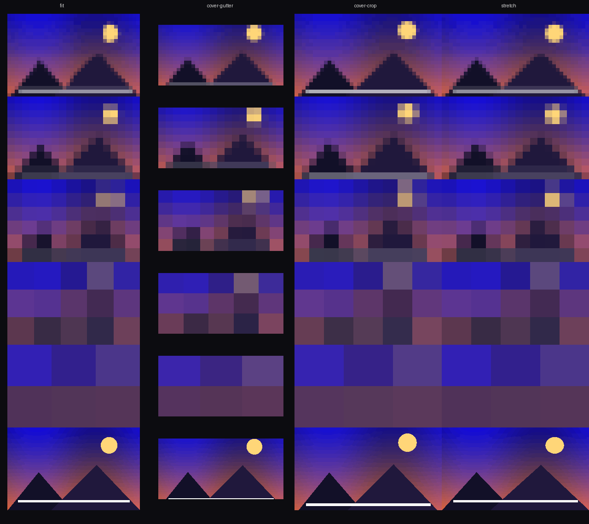

# pixelated-papers

Forced-pixelation wallpapers for [niri](https://github.com/niri-wm/niri) and
other Wayland compositors. Every wallpaper you set gets pixelated — there is
no "off" switch you have to remember to click.



*6 presets (`8 / 16 / 32 / 64 / 128 / normal`) × 4 placements
(`fit / cover-gutter / cover-crop / stretch`), same source image.*

The block sizes are literal pixels (plus `normal`). The names are
vibe, not accuracy: palette modes (`auto / nes / gb / cga / ega / vga /
gen16`) and dithers (`fs / atkinson / bayer2 / bayer4 / bayer8`) map onto
canonical tables deterministically — flavour, never hardware emulation.
The default look is unchanged: nearest-neighbour blocks over a real
image, median-cut palette.

## Quickstart

```sh
cargo install --path crates/pixpapers
pixpapers add ~/Pictures/nebula.png
pixpapers list                       # ids + current
pixpapers set <id>                   # auto-starts the daemon
pixpapers status
```

That's it: `set` starts the daemon if it isn't running and applies within
about a tenth of a second. To make it survive logout, add
`pixpapers daemon` to your compositor's autostart, or install the systemd
user unit in [`contrib/`](contrib/).

## Concepts in ten lines

- **Preset** = block size: `8 | 16 | 32 | 64 | 128 | normal`. Default **16**.
- **Placement** = how the image meets the screen: `fit` (letterbox, default),
  `cover-gutter` (image inside a colored mat), `cover-crop`, `stretch`.
- `bg_color` is the border/gutter color per wallpaper (default black).
- Every knob is **per wallpaper**: `pixpapers pixel 4a1c9f 32`,
  `pixpapers placement 4a1c9f cover-gutter`, `pixpapers bg 4a1c9f "#1a2b3c"`.
- Global defaults for new/unset entries: `pixpapers default pixel 16`.
- `disable` stops pixelating everything (originals only, placement kept);
  `enable` brings the look back.
- Originals are stored; the pixelated variants are generated at the
  **absolute minimum size** — the default look is ~6 KB, not ~2 MB — and
  cached on disk forever. Switching a cached wallpaper is a read + a stretch.
- `pixpapers export <id> 3840x2160 --pixel 8 -o /tmp/shot.png` renders
  offline with the exact same code the daemon draws with. Any tool that
  takes a PNG can carry our look.
- The daemon owns no state. The CLI writes the config; the daemon re-reads
  it on every apply. Kill it and the next command respawns it.

## Why it's fast (measured)

niri 26.04, 3840×2160 at fractional scale 1.5, release build, dev machine:

| | |
|---|---|
| cold `set` (spawn + generate + render + commit) | **91 ms** |
| hot switch between cached wallpapers, n=50 | p50 **23 ms** · p95 **45 ms** |
| variant on disk, 1080p photo @ 16 px | **6.3 KB** vs 1.94 MB original (310×) |
| variant on disk, 4K photo @ 16 px | **22 KB** vs 7.8 MB (350×) |
| idle daemon | **4.4 MB RSS · 5 fds** |
| daemon displaying a 5K buffer | ~121 MB (two output-sized shm buffers) |

The full numbers, what they mean and where they wash out are in
[docs/PERF.md](docs/PERF.md). Reproduce them with `cargo bench`,
`test/bench-daemon.sh` and `pixpapers status --bench`.

## Install

- **Arch**: PKGBUILD draft in [`contrib/packaging/`](contrib/packaging).
- **From source**: `cargo install --path crates/pixpapers` (stable toolchain ≥ 1.85).
- Binary needs `WAYLAND_DISPLAY` to render; every other command works
  headless.

## Documentation

| | |
|---|---|
| [docs/CLI.md](docs/CLI.md) | every subcommand, flag, exit code, env var |
| [docs/COMPOSITORS.md](docs/COMPOSITORS.md) | niri in depth, other compositors, X11 |
| [docs/SCALING.md](docs/SCALING.md) | integer and fractional scale, buffer sizing |
| [docs/PERF.md](docs/PERF.md) | the measured numbers and their honest reading |
| [docs/TROUBLESHOOTING.md](docs/TROUBLESHOOTING.md) | daemon won't start, nothing shows, exit 43 |
| [docs/VERIFICATION.md](docs/VERIFICATION.md) | what was actually tested, and what wasn't |
| [docs/PLAN.md](docs/PLAN.md) | design and the step-1→9 build log |

## Tested with

**niri 26.04 (8ed0da4)**, single 4K output at integer scale 1 / legacy
scale 2 with effective fractional 1.5 — see
[docs/VERIFICATION.md](docs/VERIFICATION.md) for the full matrix, including
what remains untested (multi-output, physical hotplug, other compositors).

Other wlr-layer-shell compositors (sway, hyprland, river, …) use the same
protocol and are expected to work, but are **untested** here. On hyprland,
don't run `hyprpaper` at the same time — the background layer has no
arbitration, last one wins.

## Deliberately not in v0.1

TUI, X11 support, live/animated wallpapers, auto-preset by image content,
retro palettes and dithering, MPRIS-ish hooks, a hyprpaper-style backend.
None of them are refused forever — they are out of scope for a tool whose
job is one look, done fast.

## License

`MIT OR Apache-2.0`. See [`LICENSE-MIT`](LICENSE-MIT) and
[`LICENSE-APACHE`](LICENSE-APACHE).
